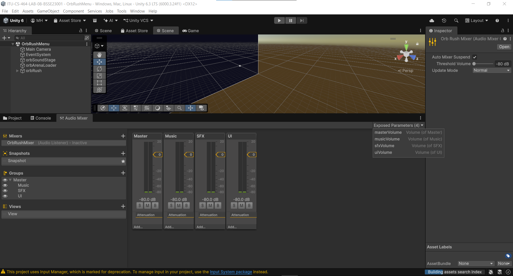

# ITU-CS-464-LAB-08 - Orb Rush Mobile Menu System

**Student Name:** Muhammad Hamza  
**Roll Number:** BSSE23001  
**Course:** CS464 - Lab 8
**Instructor:** Muhammad Raza Butt  
**Demo Video Link:** https://drive.google.com/file/d/1v-jIS9U3IlJjgz-3l5vBp0LTVn4OPSQ1/view?usp=sharing
**BUILD:** https://drive.google.com/file/d/1g3HaB2By1zAHQgXaHRhtU2dm40YixDW8/view?usp=sharing

## Scenes

| Scene          | Contents                                                                                      |
| -------------- | --------------------------------------------------------------------------------------------- |
| `OrbRushMenu`  | uGUI canvas with all 11 screens, `orbSoundStage` (audio), `orbArenaLoader`                    |
| `OrbRushArena` | `arenaCamera` with `GameSession` and `ArenaCameraShake`, `arenaListeners` (sound + particles) |

## Audio Mixer



### Behaviour while paused

| Audio        | While paused                 | How                                                                     |
| ------------ | ---------------------------- | ----------------------------------------------------------------------- |
| Gameplay SFX | freezes                      | `AudioListener.pause = true`, SFX voices respect it                     |
| Music        | keeps playing, ducked to 35% | `ignoreListenerPause = true` + duck in `OrbMusicDirector`               |
| UI sounds    | keep playing                 | `ignoreListenerPause = true` (pause/resume/slider sounds must be heard) |

## Music transitions

`OrbMusicCueListener` listens to events and asks `OrbMusicDirector` to crossfade (unscaled time, `InOutSine`).

| Event                            | Music                 |
| -------------------------------- | --------------------- |
| App start / `ArenaClosed`        | menu theme (1.2 s)    |
| `GameSession.LevelPrepared`      | arena theme (1.0 s)   |
| `GameSession.RunWon` / `RunLost` | results theme (1.4 s) |
| `GameSession.PauseChanged`       | duck down / up        |

## C# events

All events are `static event Action<...>`, raised with `?.Invoke(...)`, subscribed with `+=` in `OnEnable` and removed with `-=` in `OnDisable`, and reset with `[RuntimeInitializeOnLoadMethod(SubsystemRegistration)]` so editor domain-reload-off sessions never leak handlers.

| Publisher                                                 | Events                                                                                                   |
| --------------------------------------------------------- | -------------------------------------------------------------------------------------------------------- |
| `OrbVitals` (health system, refactored out of the player) | `Damaged(OrbHitReport)`, `Healed`, `ShieldBlocked`, `ShieldRaised`, `Died`                               |
| `OrbPickup`                                               | `Collected(PickupKind, Vector3)`                                                                         |
| `PlayerOrb`                                               | `Dashed`                                                                                                 |
| `GameSession`                                             | `LevelPrepared`, `CountdownChanged`, `RunStarted`, `ShardCollected`, `PauseChanged`, `RunWon`, `RunLost` |
| `OrbArenaLoader`                                          | `ProgressChanged`, `ArenaReady`, `ArenaClosed`                                                           |

| Subscriber (independent component) | Listens to                                 | Reaction                                   |
| ---------------------------------- | ------------------------------------------ | ------------------------------------------ |
| `OrbSfxListener`                   | pickups, vitals, dash, countdown, win/lose | gameplay sounds with pitch variation       |
| `OrbBurstListener`                 | pickups, vitals, dash, win                 | particle bursts, rings, rising text        |
| `ArenaCameraShake`                 | damage, block, dash, win/lose              | camera shake (respects the setting)        |
| `HitFlashOverlay`                  | damage, block, heal                        | full-screen colour flash                   |
| `HudScreen`                        | vitals, shards, countdown                  | hearts, shield chip, shard counter, banner |
| `OrbMusicCueListener`              | session + loader                           | music crossfades                           |
| `LoadingScreen`                    | `ProgressChanged`                          | bar and percentage                         |
| `GameSession`                      | pickups, damage, death                     | scoring, hit-stop, win/lose                |
| `PlayerOrb`                        | damage, death, shield                      | knockback, death visuals, shield ring      |

Excerpt (declaration + invoke in `OrbVitals`, subscribe/unsubscribe in `HitFlashOverlay`):

```csharp
public static event Action<OrbHitReport> Damaged;

Damaged?.Invoke(new OrbHitReport { heartsLeft = Hearts, maxHearts = MaxHearts, position = transform.position, source = source });

void OnEnable()  { OrbVitals.Damaged += onOrbDamaged; }
void OnDisable() { OrbVitals.Damaged -= onOrbDamaged; }
```

## Sounds in the game

- UI (11): hover, press, select, back, panel open, panel close, pause, resume, success, error, toggle
- Gameplay (14): shard pickup, damage, shield block, shield raise, heal, destroyed, dash, cannon fire, spike surge / drone warning, boost, countdown tick, countdown go, run won, run lost
- Repeated sounds use +/-6% pitch variation (UI +/-3%).

## Asset credits

| Asset                                                                                                                             | Author         | Licence   | Source                                                                                                 |
| --------------------------------------------------------------------------------------------------------------------------------- | -------------- | --------- | ------------------------------------------------------------------------------------------------------ |
| Interface Sounds (tick, select, back, open, close, minimize, maximize, confirmation 1-4, error, toggle, glass, pluck, drop, bong) | Kenney         | CC0 1.0   | https://kenney.nl/assets/interface-sounds (mirror: https://github.com/Calinou/kenney-interface-sounds) |
| UI Audio (click1)                                                                                                                 | Kenney         | CC0 1.0   | https://kenney.nl/assets/ui-audio (mirror: https://github.com/Calinou/kenney-ui-audio)                 |
| Starter Kit 3D Platformer sounds (coin, jump, fall)                                                                               | Kenney         | CC0 1.0   | https://github.com/KenneyNL/Starter-Kit-3D-Platformer                                                  |
| Starter Kit FPS sounds (blaster, enemy_hurt, enemy_destroy, jump_b)                                                               | Kenney         | CC0 1.0   | https://github.com/KenneyNL/Starter-Kit-FPS                                                            |
| "Faith" (menu music)                                                                                                              | Tanner Helland | CC BY 4.0 | https://github.com/tannerhelland/free-music                                                            |
| "Retribution" (arena music)                                                                                                       | Tanner Helland | CC BY 4.0 | https://github.com/tannerhelland/free-music                                                            |
| "Nevermore" (results music)                                                                                                       | Tanner Helland | CC BY 4.0 | https://github.com/tannerhelland/free-music                                                            |
| Exo 2 / Inter fonts                                                                                                               | Google Fonts   | OFL       | https://fonts.google.com                                                                               |

Music by Tanner Helland, licensed CC BY 4.0 (https://creativecommons.org/licenses/by/4.0/). No changes other than Unity import compression. Icons and in-game shapes are drawn by code (`SpriteFactory`).
